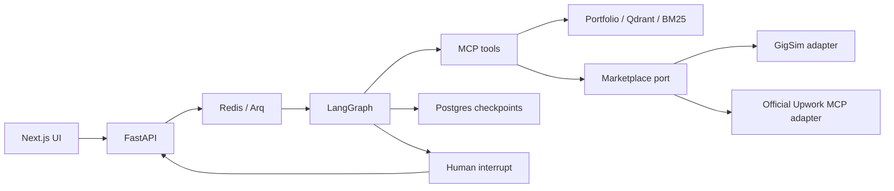

# GigBid

A freelancer copilot that will find jobs, assess risk and fit, draft evidence-grounded proposals, and pause for human approval before any external write.

**Stage: durable local proposal review.** Accounts, portfolio retrieval, manual jobs, proposal agents, Postgres checkpoints, review decisions and approved local drafts are implemented. Marketplace adapters, conversation agents and evaluations remain unfinished. No graded LLM experiments, marketplace outcomes or benchmark results exist yet.

## Start here

- [Understand the project](docs/WALKTHROUGH.md): a plain-language explanation of the parts.
- [Implementation status](docs/STATUS.md): what works, what is pending, and the next build order.
- [Architecture](docs/ARCHITECTURE.md): graphs, ports, tools and persistence boundaries.
- [Runbook](docs/RUNBOOK.md): local startup and service limitations.

## Local setup

Requirements: Python 3.11-3.13, Node.js 22+, and uv. Docker Desktop is needed for Compose.

```powershell
# Run inside the gigbid repository.
Copy-Item .env.example .env
uv sync --frozen --extra dev
uv run python scripts/export_openapi.py
cd apps/web
npm ci
npm run generate:api
npm run dev
```

In a second terminal at the repository root:

```powershell
uv run alembic upgrade head
uv run uvicorn apps.api.main:app --reload
```

Postgres must be running first. Start only that service with `docker compose --project-directory . -f infra/docker-compose.yml up -d postgres`. Full Compose startup applies migrations automatically before the API starts.

Open the frontend at http://localhost:3000 and API documentation at http://localhost:8000/docs.
Create an account at `/sign-in`, configure your profile at `/onboarding`, and upload CVs/case studies at `/portfolio`. Add a manual job at `/inbox`; open its run to review evidence, edit, reject or approve a local draft. `/runs` lists saved runs. Pipeline, messaging and analytics remain unfinished. `/health/ready` checks database access and the account migration.

For portfolio indexing, start `redis`, `qdrant` and `worker` with Compose. The first indexing/search downloads CPU open models into the shared model cache. On Windows, use the Linux Docker worker; Arq's native shutdown uses Unix signals. The browser shows queued/indexing/failed/ready states, and the worker recovers saved queued uploads after a restart.

Proposal agents use native Ollama by default. Pull the candidate models named in `agent/config.yaml`: `qwen3.5:4b`, `qwen3:8b` and the eligible-role fallback `llama3.2:1b`. The Docker worker reaches native Ollama through `WORKER_OLLAMA_BASE_URL`; `localhost` inside the worker points to the worker itself. See the runbook for optional container inference.

## Checks

```powershell
uv run pytest
uv run ruff check .
uv run python scripts/check_structure.py
cd apps/web
npm run typecheck
npm run build
npx playwright install chromium
npm run test:e2e
```

Tests cover accounts, tenant isolation, retrieval, graph/MCP contracts, Postgres pause/resume, stale approvals, worker cancellation and idempotent local commits. Browser tests cover account/profile/portfolio flows and local proposal approve/reject/edit/compliance flows. Set `GIGBID_TEST_DATABASE_URL` for disposable Postgres schemas; proposal browser tests require it. SQLite supports the other isolated tests. Role and embedding fixtures in browser tests measure UI/control behavior, not model quality. One marketplace-outage browser flow remains explicitly pending.

Compose configuration:

```powershell
docker compose --project-directory . -f infra/docker-compose.yml config --quiet
docker compose --project-directory . -f infra/docker-compose.yml up --build
```

Default Compose services are web, API, worker, Postgres, Redis and Qdrant. Ollama is available under the optional `container-inference` profile; its host port is 11435 so it does not conflict with native Ollama on 11434. No inference models are downloaded automatically. GigSim requires an instructor image. MCP HTTP transport stays disabled until bearer authentication exists; agents use the tenant-bound Portfolio server over stdio.

## What the skeleton contains

- FastAPI accounts, profiles, portfolio, manual jobs, durable runs, approvals, local drafts and SSE.
- Next.js account/profile/portfolio forms, inbox, job detail, proposal review and run activity.
- Generated API types, rather than a handwritten copy of the API schema.
- Pydantic handoffs and typed graph state.
- Bid StateGraph business nodes with parallel analysis, bounded Critic revisions and edit/reverify interrupts. The worker supplies production dependencies; conversation business nodes remain unimplemented.
- Three official-SDK MCP server registrations, schemas, resources, prompt template and contract snapshot.
- A marketplace interface with GigSim and Upwork adapter stubs.
- PDF/Markdown/text ingestion and implemented V0, V1, V2, V3 and V8 retrieval components. V8 uses a bounded LangGraph retrieve/grade/correct loop.
- Portfolio source metadata includes persona, type, project, skills, date, industry and proposal outcome; retrieved chunks retain source IDs and PDF pages.
- Sentence claim verification and rule-promoted LangGraph style/outcome memory are implemented. Settings exposes edit history, confirmation and removal. Outcome ingestion still requires the real marketplace adapter; calibration and graded evaluations remain pending.
- Docker and CI scaffolding, pinned dependencies, and uv/npm lockfiles.

## Architecture



## Assignment results and portfolio deliverables

Not produced yet: demo GIF, public URL, reviewer account, trace links, RAG and orchestration results tables, tool-design study, report, published Portfolio MCP package, technical write-up, and demo video. `evals/results/` is intentionally empty. Never report fixture tests as experimental results.

The document says GigSim, persona corpora, the policy pack and labelled dev sets are provided separately. This repository supplies the code skeleton ourselves. If those assets are not provided, clarify their expected source with the instructor; do not silently replace grading assets with invented equivalents.

Model names in `agent/config.yaml` are candidate defaults, not an evaluation-backed selection. Open models are mandatory for the deployed profile. Google API access may be used for hosted Gemma when supported; Google credentials are not needed to inspect this skeleton.

## AI assistance

See [AI_USAGE](docs/AI_USAGE.md). The author must understand and verify the eventual implementation and measured results.
