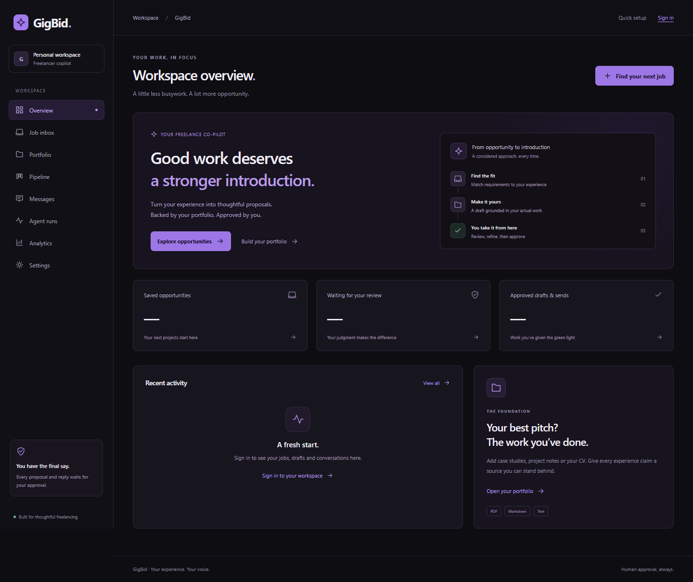
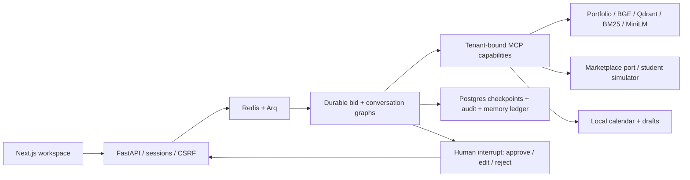

# GigBid

A freelancer workspace for finding suitable jobs, drafting evidence-backed proposals and
reviewing every outgoing action. Built with LangGraph, MCP, FastAPI and Next.js.



**Working locally:** accounts, portfolios, durable proposal/reply review, the student-built
marketplace simulator, scheduled job imports, pipeline, analytics and a responsive dark UI.
Public deployment and parts of the research programme remain unfinished. No real Upwork
client is contacted, and simulated replies or hires are not real business outcomes.

## Run

```text
uv sync --frozen --extra dev
python -m scripts.download_student_data
# Copy .env.example to .env and configure local values.
docker compose --project-directory . -f infra/docker-compose.yml up --build
```

The prepared catalogue contains 600 historical job texts with clearly labelled synthetic
context. Without prepared data, the simulator uses fully synthetic jobs and identifies that
in `/health`. See [the data card](docs/DATA_CARD.md) for licenses, attribution and limitations.
The original instructor GigSim was not delivered; `simulator/` is our independent implementation.

Open [the app](http://localhost:3000). Create an account, upload evidence, and connect the
student simulator from the inbox or Settings. Search jobs, open one and start analysis.
Review its evidence and exact preview before approving. Use Sync simulator activity to
import lifecycle events and client replies. Every reply requires another approval.

The worker normally calls native Ollama at `host.docker.internal:11434`. Pull the models in
`agent/config.yaml` first. Optional container inference runs with the `container-inference`
profile. Models, downloads and queued indexing take time; none of the tests below prove
proposal quality. [Runbook](docs/RUNBOOK.md) and [implementation status](docs/STATUS.md).

Create separate fictional reviewer accounts and portfolios with `python -m scripts.seed`.
Private generated credentials stay in ignored `work/demo-accounts.json`; never publish them.

## Architecture



The Analyst, Risk Assessor and Matcher branches run in parallel. Typed handoffs, evidence
re-reads, bounded Critic loops, token/step limits and checkpointed approvals govern execution.
An approval binds a version, interrupt ID, digest and exact write payload. The simulator's
idempotency receipt prevents duplicate debits; SQL reconciliation preserves observed effects.
[Rendered graphs](docs/GRAPHS.md) · [Architecture](docs/ARCHITECTURE.md) · [Tools](docs/TOOLS.md).

## Measured retrieval

Controlled synthetic study: 60 answerable project tasks and six unrelated tasks, with real
BGE-small embeddings and MiniLM cross-encoder inference. This is easier than independently
labelled real job relevance. Source: [results.json](evals/results/student-retrieval/results.json).

| Variant | Recall@5 | MRR@5 | nDCG@10 | p95 seconds | Unrelated tasks retrieving evidence |
|---|---:|---:|---:|---:|---:|
| V0 dense | 1.000 | 0.987 | 0.990 | 0.050 | 6/6 |
| V1 decomposition | 0.725 | 0.529 | 0.631 | 0.068 | 6/6 |
| V2 hybrid | 0.983 | 0.858 | 0.894 | 0.061 | 6/6 |
| V3 hybrid + rerank | 1.000 | 1.000 | 1.000 | 3.342 | 6/6 |
| V8 corrective | 1.000 | 1.000 | 1.000 | 10.715 | 0/6 |

The hypothesis that reranking improves recall over V0 was not supported here. V3 improved
ordering; V8 improved abstention at greater latency. The declared recall/ordering/latency
selection rule chooses V3. This does not establish better client reply rates.

The two-model graph study is ongoing. The small all-role configuration failed grounding on
most positive jobs; those failures are retained. See [measured results](docs/RESULTS.md),
[study plan](evals/STUDENT_RESEARCH_PLAN.md), and [evaluation guide](docs/EVALUATION.md).
The 40-task tool-design and 50-job orchestration comparisons are not yet completed.
Human judge calibration, blind classmate ratings and hidden-test results are not fabricated.

## Verification

```text
python -m pytest
python -m ruff check .
python scripts/check_structure.py
python scripts/render_graphs.py --check
cd apps/web
npm run typecheck
npm run build
npm run test:e2e
```

Set `GIGBID_TEST_DATABASE_URL` for isolated Postgres schemas. The latest full backend run
passed 149 tests with four opt-in skips. Browser checks passed the 14 existing flows and
then the added simulator outage-to-reply flow in a separate targeted run. Deterministic
browser/control fixtures are not quality measurements. [Verification history](docs/VERIFICATION.md).

## Submission status

Repository: [raahim-ibrar/GigBidA2](https://github.com/raahim-ibrar/GigBidA2).
No public live URL yet. Reviewer details must be supplied privately after deployment.
Official Upwork OAuth, GitHub ingestion, public trace links and remaining studies still need
completion. The required video/GIF is excluded from the current work at the user's request.

[Portfolio MCP install instructions](mcp_servers/portfolio/README.md) ·
[Data provenance](docs/DATA_CARD.md) · [AI assistance disclosure](docs/AI_USAGE.md).
