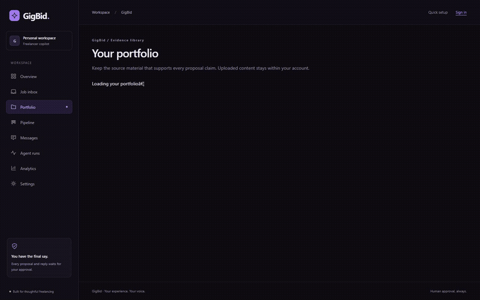
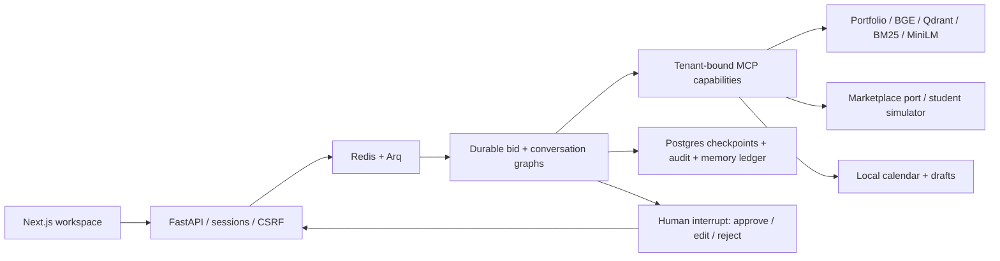

# GigBid

A freelancer workspace for finding suitable jobs, drafting evidence-backed proposals and
reviewing every outgoing action. Built with LangGraph, MCP, FastAPI and Next.js.



[Watch the three-minute demo](https://raahim-ibrar.github.io/GigBidA2/demo.html) ·
[Published technical article](https://raahim-ibrar.github.io/GigBidA2/)

**Working locally:** accounts, portfolios, durable proposal/reply review, the student-built
marketplace simulator, scheduled job imports, pipeline, analytics and a responsive dark UI.
The temporary public demo is currently off. Real Upwork OAuth and job reads are verified;
no real client was contacted. Simulated replies and hires are not real business outcomes.

## Run

```text
uv sync --frozen --extra dev
python -m scripts.download_student_data
# Copy .env.example to .env and configure local values.
docker compose --project-directory . -f infra/docker-compose.yml up --build
```

The prepared catalogue contains 600 historical job texts with clearly labelled synthetic
context. Without prepared data, the simulator uses fully synthetic jobs and identifies that
in `/health`. See [the data card](docs/DATA_CARD.md) for licenses, attribution and limitations.
The original instructor GigSim was not delivered; `simulator/` is our independent implementation.

Open [the app](http://localhost:3000). Create an account, upload evidence, and connect the
student simulator from the inbox or Settings. Search jobs, open one and start analysis.
Review its evidence and exact preview before approving. Use Sync simulator activity to
import lifecycle events and client replies. Every reply requires another approval.

The worker normally calls native Ollama at `host.docker.internal:11434`. Pull the models in
`agent/config.yaml` first. Optional container inference runs with the `container-inference`
profile. Models, downloads and queued indexing take time; none of the tests below prove
proposal quality. [Runbook](docs/RUNBOOK.md) and [implementation status](docs/STATUS.md).

Create separate fictional reviewer accounts and portfolios with `python -m scripts.seed`.
Private generated credentials stay in ignored `work/demo-accounts.json`; never publish them.

## Architecture



The Analyst, Risk Assessor and Matcher branches run in parallel. Typed handoffs, evidence
re-reads, bounded Critic loops, token/step limits and checkpointed approvals govern execution.
An approval binds a version, interrupt ID, digest and exact write payload. The simulator's
idempotency receipt prevents duplicate debits; SQL reconciliation preserves observed effects.
[Rendered graphs](docs/GRAPHS.md) · [Architecture](docs/ARCHITECTURE.md) · [Tools](docs/TOOLS.md).

## Measured retrieval

Controlled synthetic study: 60 answerable project tasks and six unrelated tasks, with real
BGE-small embeddings and MiniLM cross-encoder inference. This is easier than independently
labelled real job relevance. Source: [results.json](evals/results/student-retrieval/results.json).

| Variant | Recall@5 | MRR@5 | nDCG@10 | p95 seconds | Unrelated tasks retrieving evidence |
|---|---:|---:|---:|---:|---:|
| V0 dense | 1.000 | 0.987 | 0.990 | 0.050 | 6/6 |
| V1 decomposition | 0.725 | 0.529 | 0.631 | 0.068 | 6/6 |
| V2 hybrid | 0.983 | 0.858 | 0.894 | 0.061 | 6/6 |
| V3 hybrid + rerank | 1.000 | 1.000 | 1.000 | 3.342 | 6/6 |
| V8 corrective | 1.000 | 1.000 | 1.000 | 10.715 | 0/6 |

The hypothesis that reranking improves recall over V0 was not supported here. V3 improved
ordering; V8 improved abstention at greater latency. The declared recall/ordering/latency
selection rule chooses V3. This does not establish better client reply rates.

<!-- rag-e2e-table:start -->

| Variant | Recall@5 | nDCG@10 | Unsupported / available proposal | Judge / 5 | LLM-client reply / submitted | p95 agent/job seconds | USD/proposal |
|---|---:|---:|---:|---:|---:|---:|---:|
| V0 | 0.358 | 0.623 | 0.00 (n=5) | 3.80 | 2/2 | 368.16 | unknown |
| V3 | 0.488 | 0.891 | 0.00 (n=2) | 4.00 | 1/1 | 124.43 | unknown |

All columns use the same nine matched jobs per variant and portfolio corpus. Retrieval is a retrospective CPU replay (k=5/10, synthetic topic-family gold); Generation observations are frozen. Quality is conditional on available drafts; failures remain in assigned-job totals. LLM clients assess the three submissions. Non-submissions cannot receive replies. Billing is unknown.

Intention-to-treat LLM replies: V0 2/9; V3 1/9. This small cohort establishes no reliable winner.

<!-- rag-e2e-table:end -->

The supplemental end-to-end table is derived by
`python -m evals.fidelity_analysis` without inference from
[matched-cohort retrieval and LLM-client outcomes](evals/results/evaluation-fidelity-v1/summary.json).
It does not replace the larger retrieval or architecture studies.

The two open-model cohorts are complete (30 jobs each); grounding failures are retained.
The 150-run optional Gemini architecture comparison is complete: ReAct had 41/50
error-free runs, supervisor 24/50, and the custom graph 37/50. Intermediate decision
accuracy must not be confused with full-run success. The 40-task tool study, 30-item
human calibration and twelve-pair classmate panel are also recorded. X2 reply rates
were 48% versus 56% with LLM clients, Fisher p=0.778: no significant benefit established.
See [measured results](docs/RESULTS.md), [technical narrative](docs/TECHNICAL_WRITEUP.md),
[study plan](evals/STUDENT_RESEARCH_PLAN.md), and [evaluation guide](docs/EVALUATION.md).
Hidden-test results are unavailable before grading.

| Architecture, 50 matched jobs each | Error-free | Correct intermediate decisions | Simulator submissions | LLM-client replies | p95 seconds |
|---|---:|---:|---:|---:|---:|
| ReAct | 41 | 36 | 40 | 25 | 138.55 |
| Supervisor | 24 | 24 | 19 | 12 | 186.13 |
| Custom graph | 37 | 49 | 30 | 26 | 178.69 |

These are optional Gemini architecture runs, separate from the two open-weight cohorts.
ReAct submitted five scam controls to the isolated simulator; the supervisor submitted
one and the custom graph none. Higher completion alone is not a safe selection rule.
Source: [LLM-client replay and frozen generation metrics](evals/results/evaluation-fidelity-v1/summary.json).
All 89 frozen architecture submissions were replayed with the LLM client. Agent runs,
failures and timings are unchanged; earlier rule-client observations remain archived.

## Verification

Install the research extra for the full unit/contract suite, including the native
research-model transport checks: `uv sync --frozen --extra dev --extra research`.
These tests use controlled provider fixtures and do not make model API calls.

```text
python -m pytest
python -m ruff check .
python scripts/check_structure.py
python -m scripts.check_assignment
python scripts/render_graphs.py --check
cd apps/web
npm run typecheck
npm run build
npm run test:e2e
```

Set `GIGBID_TEST_DATABASE_URL` for isolated Postgres schemas. The latest full backend run
passed 252 tests with five opt-in skips ([recorded check](evals/results/assignment-ci-verification.json)).
The recorded Chromium suite passed 17 flows, including safe checkpoint replay. Deterministic
browser/control fixtures are not quality measurements. [Verification history](docs/VERIFICATION.md).

[Assignment-specific repository checks](docs/ASSIGNMENT_CI.md) enforce protected paths,
prompt locations, reviewed numeric evidence bindings and redacted secret scanning.

`make eval` runs a fresh 30-job control evaluation through production graphs, MCP,
approval transactions and the rule simulator. It checks retrieval, decisions, grounding
and reply-rate thresholds. Deterministic model/embedding fixtures require no API key or
GPU and do not measure prompt/model quality. Every PR runs this smoke plus the test
workflows. Use `make eval-recorded EVAL_ARGS="--manifest PATH"` to score frozen research
outputs separately. [Latest control evidence](evals/results/ci-control-30/summary.json).

The run viewer can fork an owned checkpoint into a new bid run. Selecting a later write
stage returns through verification and always requires a new approval; the source run
and its audit history remain intact.

## Submission status

Repository: [raahim-ibrar/GigBidA2](https://github.com/raahim-ibrar/GigBidA2).
The former temporary tunnel is off; its old URL is not an active deployment.
Demo hosting depends on the laptop, Docker and tunnel, and changes URL after restart.
Actual verification: [demo results](evals/results/demo-deployment.json) and
[demo hosting notes](docs/DEMO_HOSTING.md). Reviewer credentials are kept private.
The optional [student-credit Azure/Vercel configuration](docs/DEPLOYMENT.md) is prepared
but no Azure resources were provisioned.
The installable [Portfolio MCP package](mcp_servers/portfolio/README.md) supports uvx
or Docker. Its optional HTTP demo is currently off. Private connection details remain
in ignored files. GitHub import reads public README and source-code files through official read-only MCP,
pins the commit, and indexes it in the signed-in account's portfolio.

Public LangSmith traces contain measured timings, token usage and MCP calls, with source
content omitted: [approved proposal and actual API crash/restart](https://smith.langchain.com/public/f91fd52f-2903-4c50-8160-f2415edd1ea7/r),
[real-model Critic loop](https://smith.langchain.com/public/039792a8-3f8a-4d96-863e-8a9b43e3ae88/r),
[scam rejected](https://smith.langchain.com/public/b55b89d4-881e-4c66-8516-cef09cba7cd2/r),
[injection rejected](https://smith.langchain.com/public/06918fe8-f9e4-4551-a7d8-f1435f522869/r).
See [trace evidence](evals/results/public-traces.json) and [tracing policy](docs/TRACING.md).
The [56-call injection comparison](evals/results/injection-boundary-v2/README.md) is complete.
It does not establish a security improvement; model failures and paired outcomes are reported.
Real Upwork OAuth, account-scoped encrypted credentials and live job reads are verified.
See [Upwork setup and limits](docs/UPWORK.md) and [sanitized live evidence](evals/results/upwork-live-verification.json).
Provider-preview preparation is approval-gated and fixture-tested; no live write was
attempted. Final submissions and direct message sending remain disabled.
The demo recording uses a fictional account, real hosted inference, an actual API
process restart and one verified simulator submission receipt; it makes no live Upwork writes.
See [submission checklist](docs/SUBMISSION.md) for artifacts and remaining external limitations.

[Portfolio MCP install instructions](mcp_servers/portfolio/README.md) ·
[Data provenance](docs/DATA_CARD.md) · [AI assistance disclosure](docs/AI_USAGE.md).
