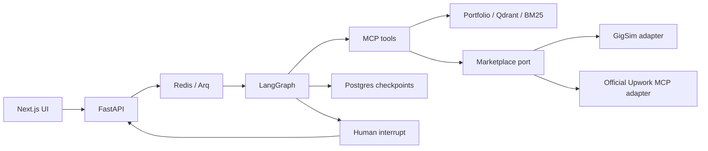

# GigBid

A freelancer copilot that will find jobs, assess risk and fit, draft evidence-grounded proposals, and pause for human approval before any external write.

**Stage: accounts and portfolio evidence.** Accounts, persistent sessions, profiles, uploads, background indexing, source revisions and evidence retrieval work. The proposal agents and marketplace adapters are still being built. No graded LLM experiments, marketplace outcomes or benchmark results exist yet.

## Start here

- [Understand the project](docs/WALKTHROUGH.md): a plain-language explanation of the parts.
- [Implementation status](docs/STATUS.md): what works, what is pending, and the next build order.
- [Architecture](docs/ARCHITECTURE.md): graphs, ports, tools and persistence boundaries.
- [Runbook](docs/RUNBOOK.md): local startup and service limitations.

## Local setup

Requirements: Python 3.11-3.13, Node.js 22+, and uv. Docker Desktop is needed for Compose.

```powershell
# Run inside the gigbid repository.
Copy-Item .env.example .env
uv sync --frozen --extra dev
uv run python scripts/export_openapi.py
cd apps/web
npm ci
npm run generate:api
npm run dev
```

In a second terminal at the repository root:

```powershell
uv run alembic upgrade head
uv run uvicorn apps.api.main:app --reload
```

Postgres must be running first. Start only that service with `docker compose --project-directory . -f infra/docker-compose.yml up -d postgres`. Full Compose startup applies migrations automatically before the API starts.

Open the frontend at http://localhost:3000 and API documentation at http://localhost:8000/docs.
Create an account at `/sign-in`, configure your profile at `/onboarding`, and upload CVs/case studies at `/portfolio`. Other product pages are still route shells. `/health/ready` checks database access and the account migration.

For portfolio indexing, start `redis`, `qdrant` and `worker` with Compose. The first indexing/search downloads CPU open models into the shared model cache. On Windows, use the Linux Docker worker; Arq's native shutdown uses Unix signals. The browser shows queued/indexing/failed/ready states, and the worker recovers saved queued uploads after a restart.

## Checks

```powershell
uv run pytest
uv run ruff check .
uv run python scripts/check_structure.py
cd apps/web
npm run typecheck
npm run build
npx playwright install chromium
npm run test:e2e
```

Tests cover accounts, password hashing, CSRF, session expiry/revocation, user isolation and profile persistence after restart, plus graph/MCP contracts. Browser tests cover registration, profile setup, sign-out, sign-in and saved settings. Full onboarding with portfolio upload and the other assignment end-to-end flows remain pending. Browser tests use a disposable SQLite database. Python integration tests use Postgres when `GIGBID_TEST_DATABASE_URL` is set, otherwise SQLite.

Compose configuration:

```powershell
docker compose --project-directory . -f infra/docker-compose.yml config --quiet
docker compose --project-directory . -f infra/docker-compose.yml up --build
```

Default Compose services are web, API, worker, Postgres, Redis, Qdrant and Ollama. No models are downloaded automatically. GigSim requires an instructor image. MCP HTTP transport stays disabled until bearer authentication exists; the servers currently register tools over stdio. See the runbook before enabling either optional profile.

## What the skeleton contains

- FastAPI liveness/readiness, OpenAPI, real account/profile endpoints and protected feature stubs.
- Next.js account/profile forms plus TypeScript shells for remaining screens.
- Generated API types, rather than a handwritten copy of the API schema.
- Pydantic handoffs and typed graph state.
- Bid and conversation StateGraph builders with injectable nodes, parallel analysis, bounded Critic routing and an interrupt gate. Default business nodes are unimplemented.
- Three official-SDK MCP server registrations, schemas, resources, prompt template and contract snapshot.
- A marketplace interface with GigSim and Upwork adapter stubs.
- PDF/Markdown/text ingestion and implemented V0, V1, V2, V3 and V8 retrieval components. V8 uses a bounded LangGraph retrieve/grade/correct loop.
- Portfolio source metadata includes persona, type, project, skills, date, industry and proposal outcome; retrieved chunks retain source IDs and PDF pages.
- Memory, claim verification and graded evaluation entry points still need implementation.
- Docker and CI scaffolding, pinned dependencies, and uv/npm lockfiles.

## Architecture



## Assignment results and portfolio deliverables

Not produced yet: demo GIF, public URL, reviewer account, trace links, RAG and orchestration results tables, tool-design study, report, published Portfolio MCP package, technical write-up, and demo video. `evals/results/` is intentionally empty. Never report fixture tests as experimental results.

The document says GigSim, persona corpora, the policy pack and labelled dev sets are provided separately. This repository supplies the code skeleton ourselves. If those assets are not provided, clarify their expected source with the instructor; do not silently replace grading assets with invented equivalents.

Model names in `agent/config.yaml` are candidate defaults, not an evaluation-backed selection. Open models are mandatory for the deployed profile. Google API access may be used for hosted Gemma when supported; Google credentials are not needed to inspect this skeleton.

## AI assistance

See [AI_USAGE](docs/AI_USAGE.md). The author must understand and verify the eventual implementation and measured results.
