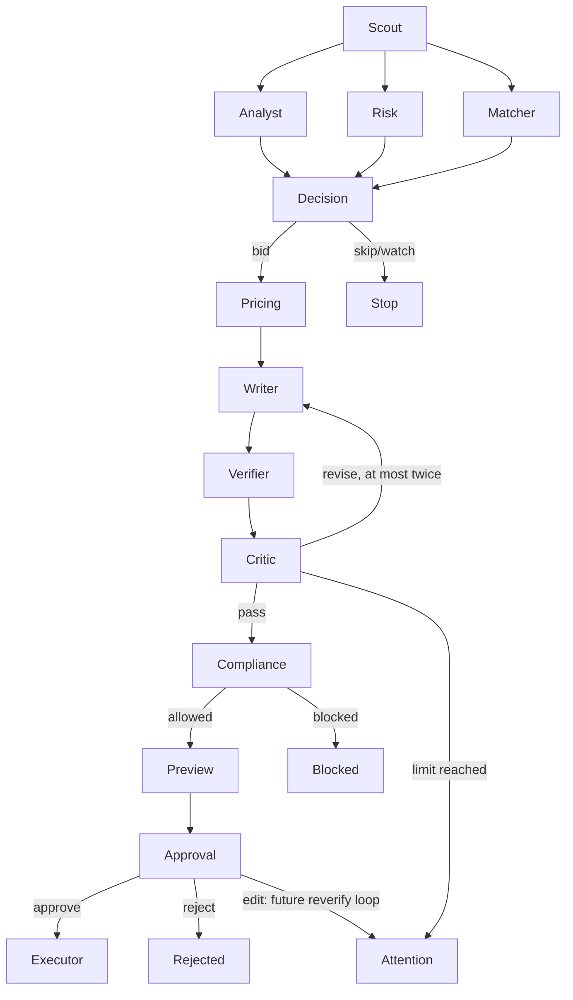
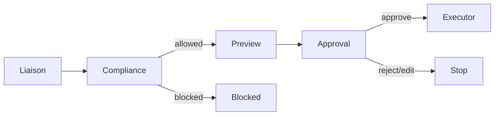

# Architecture

Stage: skeleton. Diagrams describe the intended flow; default business nodes are stubs.

The three analysis branches receive the raw post simultaneously. Each writes separate fields; progress events use an append reducer. Decision waits for all branches. There is no assumption that Matcher can read an Analyst result in the same parallel superstep.

All marketplace capabilities sit behind `MarketplacePort`. Marketplace MCP tools own the adapter. GigSim uses its supplied API; the live adapter must use official Upwork MCP and OAuth. Exact live tool names must come from authenticated discovery, not guesswork.

Postgres will own users, business entities, checkpoints, approvals, durable idempotency/audit records and promoted memory. Redis supports Arq work scheduling. Qdrant plus a lexical index will support Portfolio MCP retrieval. Agents never directly query these stores; infrastructure and MCP implementations own those operations.

The API will enqueue work and stream persisted progress events. Approvals must verify tenant ownership, thread identity and the reviewed draft/preview version before resuming. A separate executor must validate authorization again at the MCP write boundary. Human approval and an idempotency key are distinct controls.

Production must supply a Postgres saver; unit tests use InMemorySaver only to verify control flow. The checkpointer must be held open for the graph's full worker lifetime. Crash recovery and exactly-once writes remain unimplemented and unproven.

State, trace and long-term memory remain separate. Trace events require PII filtering before export. Style and outcome memory use separate tenant namespaces and explicit promotion rules; raw tool outputs are not memory candidates.
