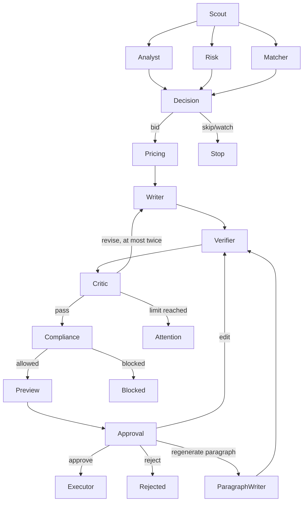
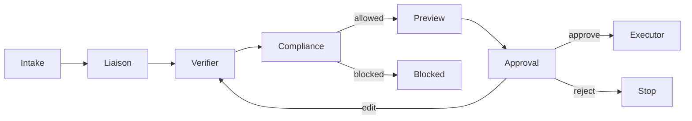

# Architecture

Stage: working local proposal/conversation workflows. Provider execution and graded
experiments are still incomplete. [GRAPHS.md](GRAPHS.md) contains Mermaid generated
directly from the compiled graph topology, checked in CI with
`python scripts/render_graphs.py --check`.

The three analysis branches receive the raw post simultaneously. Each writes separate fields; progress events use an append reducer. Decision waits for all branches. There is no assumption that Matcher can read an Analyst result in the same parallel superstep.

Business node implementations live in `agent/proposal_nodes.py` and
`agent/conversation_nodes.py`; the worker injects their dependencies into the graph
builders. The older individual files under `agent/nodes/` are scaffold entry points,
not the production runtime. Their presence does not establish another implementation.

All future marketplace capabilities sit behind `MarketplacePort`. Its GigSim and
Upwork implementations remain stubs. Exact schemas and live tool names must come
from the supplied simulator and authenticated official MCP discovery, not guesswork.
The current path uses manual jobs/messages and never sends an application or message.

Postgres owns accounts, jobs, message history, business records, checkpoints,
approval/audit receipts and a memory-promotion ledger. Redis/Arq runs indexing,
long graph segments and reconciliation. Qdrant and BM25 support Portfolio MCP.
The host binds tenant/run identity to Portfolio and Workspace sessions; the model
cannot choose another account. Business nodes receive tool capabilities, not database
connections. Infrastructure controls persistence and MCP implementations control tools.

The API persists intake/decisions before queueing and streams persisted redacted
events over SSE. A review binds tenant ownership, run version, draft digest and the
specific LangGraph interrupt. Edits and one-paragraph regeneration return through
verification, Critic and compliance before a fresh interrupt. Regeneration splices
only the selected paragraph; complete verified text keeps its original formatting.
No model-driven regeneration is counted as a human style edit.

The production runtime holds a Postgres checkpointer connection and per-run advisory
lock for a worker segment. A worker token fences stale metadata updates. Saved token
reservations and node-attempt counts survive resumes and explicit retries. Recoverable
model/connection failures allow three user-requested retries; exhausted runs remain
visible. Budgets, policy failures and invalid evidence cannot be bypassed by retrying.

Approved proposal saves use an idempotent local SQL artifact transaction. Workspace
holds/email drafts recheck the exact approved preview, sources and calendar slots at
commit. A committed local effect can be recovered after checkpoint loss. These checks
do not establish exactly-once external provider behavior; that needs provider-side
idempotency, authentication and reconciliation.

Pipeline and analytics read local artifacts and adapter-only provider receipts.
Manual drafts never establish submission/reply/hire outcomes. Measured worker
segments exclude review wait; missing usage/spend is unknown. The provider receipt
hook is tested with explicit development fixtures, not a connected marketplace.

State, execution events and promoted memory remain separate. Style/outcome values
use distinct tenant namespaces. Style patterns need edits to three distinct drafts
plus explicit confirmation; outcome patterns require verified provider observations.
Removal tombstones repair stale mirrors. Full edit diffs remain private business
history, not recall candidates. End-to-end external trace export is still pending.

Evaluation tools consume explicit recorded observations and preserve provenance.
They do not run missing simulator experiments or certify model quality. See
[EVALUATION.md](EVALUATION.md) for scoring contracts and remaining research work.
