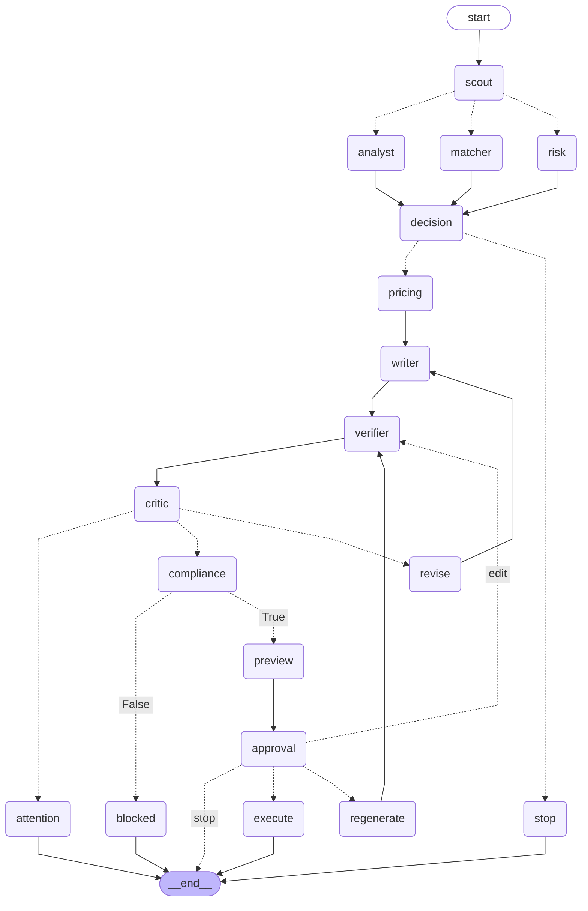
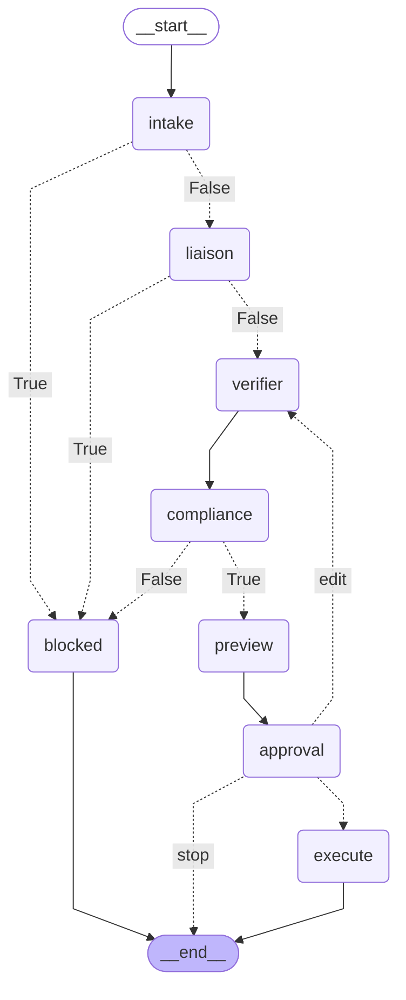

# Graphs generated from code

Generated by `python scripts/render_graphs.py`. No business node is executed. The in-memory saver is used only for topology inspection; production uses Postgres.

## Bid graph

## Conversation graph

